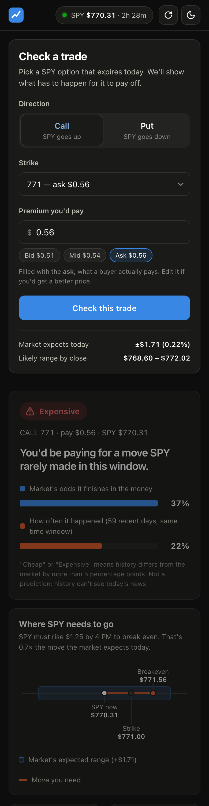

# 0DTE Trade Checker

**Check a same-day (0DTE) SPY option before you buy it.** Pick a call or put and a strike. The app shows what SPY has to do for the trade to pay off, how likely the market thinks that is, how fast the option melts if nothing happens, and whether SPY's real history agrees with the price.

> Educational tool, not financial advice. Quotes are indicative or delayed.




## What it shows

| # | Output | How it's computed |
|---|---|---|
| 1 | **Breakeven at 4 PM** | strike + premium (call) / strike − premium (put). Premium defaults to the **ask**, what a buyer really pays |
| 2 | **Market's expected move** | from the at-the-money straddle: its implied vol re-centred on spot, `√(2/π)·S·σ·√T` |
| 3 | **Chance it finishes in the money / of profit** | Black-Scholes `N(d₂)` with the option's own implied vol (solved from its mid price); profit = same at the breakeven |
| 4 | **Time decay** | theta in $/hour, plus a direct re-price one hour later (or at the close) with SPY unchanged |
| 5 | **History check** | how often SPY actually moved that far: last ~60 days of 5-min bars *from this time of day to the close*, and ~3 years of daily open→close moves scaled by √time |
| 6 | **Verdict** | market odds vs history: history > market + 5 pts → **Cheap**, < market − 5 pts → **Expensive**, else **Fair** |

Plus a chart of **gamma and theta from the open to 5 minutes before the close**, which shows why 0DTE risk explodes at the end of the day.

## Method notes

- **Black-Scholes, Greeks and an IV solver written from scratch** (`core/`). The IV solver is Newton-Raphson inside a bisection bracket. Newton divides by vega, which goes to ~0 near expiry, so the solver falls back to bisection whenever a Newton step is unusable.
- **Time to expiry:** `T = minutes until 4:00 PM ET / 525,600` (ACT/365). During a 0DTE session every remaining minute is a trading minute. Because IV is solved with the same `T`, prices, probabilities and theta/hour don't depend on the convention; only the displayed IV number does.
- **Spot from put-call parity:** `S = C − P + K·e^(−rT)` near the money. Free feeds can disagree. Yahoo's option quotes lag its stock price by ~15 min, and Alpaca's free IEX "last trade" can be 30 min old. Backing spot out of the option quotes keeps every number consistent with the prices actually used.
- **Quote cleaning:** drop zero bids, crossed quotes, and spreads wider than max($0.10, 25% of mid).
- **Data:** Alpaca's free *indicative* options feed (via `alpaca-py`), falling back to yfinance; history from yfinance; risk-free rate from the 13-week T-bill (`^IRX`).

## Limitations (honest list)

- Indicative / delayed quotes, not the official OPRA feed.
- SPY options are American-style and physically settled; Black-Scholes is European. The difference is negligible at 0DTE, **except in the final minutes**: implied vol jumps (18% → 75%+ was observed), likely because exercise decisions can still react to after-hours moves until ~5:30 PM. The app warns in the last 15 minutes.
- One constant volatility per option; the real market has a smile/skew.
- "Chance of profit" reuses the option's IV at the breakeven (ignores the smile).
- The probabilities are risk-neutral (what prices imply), not real-world forecasts.
- History can't see today's news (Fed, CPI). The daily version assumes moves spread evenly through the day; real intraday volatility is U-shaped, which is why the intraday version is preferred.
- Options usually price above realized moves (the volatility risk premium), so **"Expensive" is common, and that doesn't make selling them free money.**

## Run it locally

```bash
python -m venv .venv
.venv/bin/pip install -r requirements.txt
cp .env.example .env          # add your Alpaca PAPER keys (free account, no deposit)
.venv/bin/uvicorn app:app --reload
```
Open http://localhost:8000. Without Alpaca keys it falls back to yfinance automatically.

Command-line versions:
```bash
.venv/bin/python scripts/show_market.py          # chain, expected move, IVs
.venv/bin/python scripts/check_trade.py call 772  # full trade check
```

## Tests

```bash
.venv/bin/pytest -q
```
148 tests, no network needed. They cover Black-Scholes against Hull's textbook values, every Greek against finite differences, IV round-trips including near-zero vega, chain cleaning and parity spot, the trade checker on a synthetic market, the history check on hand-made price paths, and the API.

## Deploy (Render, free)

The repo includes a `render.yaml` blueprint: one web service running `uvicorn app:app`, which serves both the API and the frontend.

1. Push the repo to GitHub.
2. On render.com: **New → Blueprint** → pick the repo.
3. Enter `ALPACA_API_KEY` and `ALPACA_SECRET_KEY` when asked. They live in Render's environment settings and are never committed.

## Project structure

```
core/          pure math, no data code
  black_scholes.py   price, d1/d2, probability ITM
  greeks.py          delta, gamma, vega, theta
  implied_vol.py     Newton + bisection IV solver
  expiry.py          time-to-expiry convention
data/          fetching and cleaning
  alpaca_client.py   live chain (indicative feed)
  yf_fallback.py     yfinance fallback, same shape
  chain.py           load + clean + parity spot + expected move
  history.py         daily and 5-minute SPY history
  rates.py           risk-free rate
checker/       combines everything
  trade_check.py     outputs 1–4
  history_check.py   outputs 5–6
app.py         FastAPI: /api/market, /api/check, serves web/
web/           hand-built frontend (HTML/CSS/JS, SVG charts, light/dark, responsive)
tests/
```
