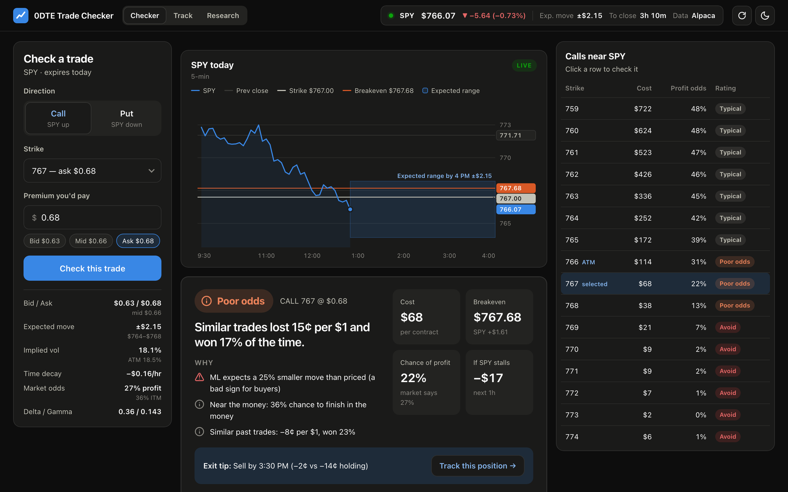
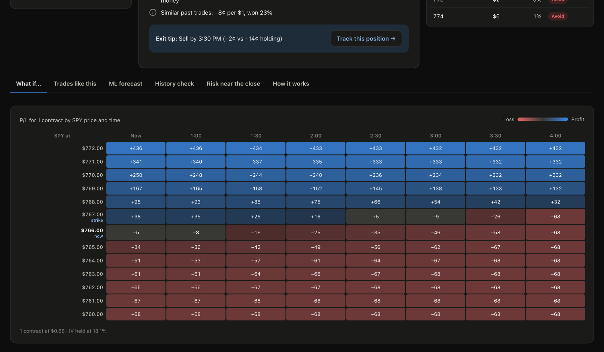
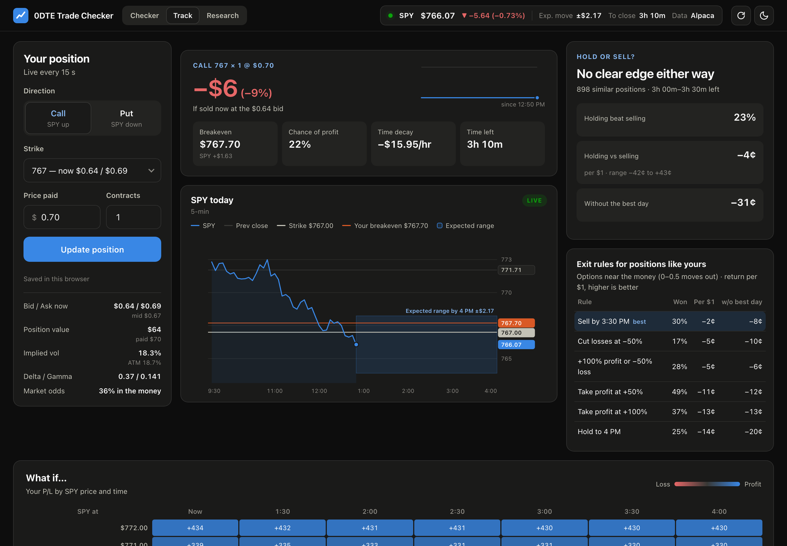
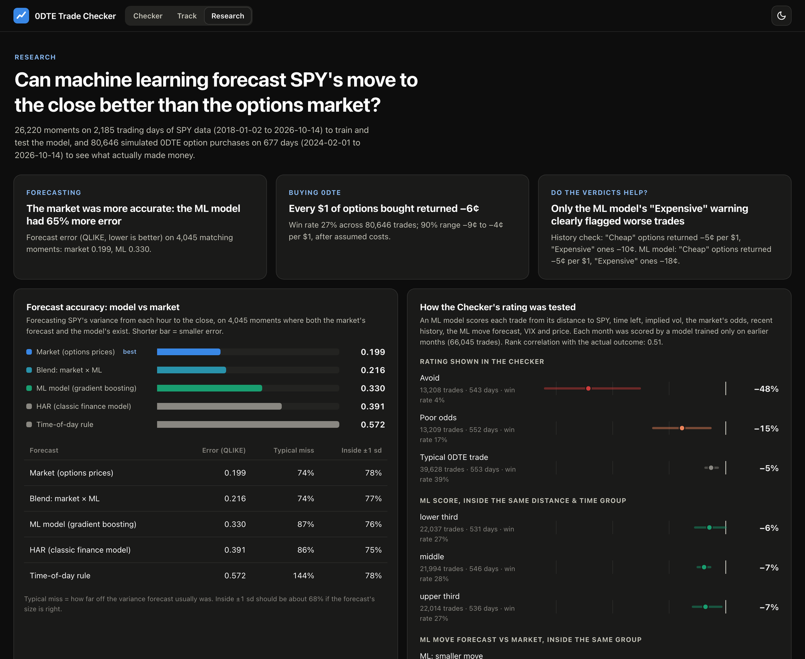

# 0DTE Trade Checker: User Guide

> **Educational tool, not financial advice.** The app explains what a trade needs and what happened to similar trades in the past. It does not tell you what to buy.

**Contents**
1. [What the app does](#1-what-the-app-does)
2. [Quick start (2 minutes)](#2-quick-start-2-minutes)
3. [Words you'll see](#3-words-youll-see)
4. [Page 1: Checker (before you buy)](#4-page-1-checker-before-you-buy)
5. [Page 2: Track (after you buy)](#5-page-2-track-after-you-buy)
6. [Page 3: Research (does any of this work?)](#6-page-3-research-does-any-of-this-work)
7. [Common questions](#7-common-questions)
8. [Limitations](#8-limitations)

---

## 1. What the app does

"0DTE" means **zero days to expiry**: SPY options that expire **today at 4:00 PM ET**. They're cheap, fast, and risky.

The app has three pages, switched with the buttons at the top:

| Page | Use it… | It answers |
|---|---|---|
| **Checker** | before you buy | *Where does SPY need to go, how likely is that, and what happened to trades like this before?* |
| **Track** | after you buy | *How am I doing right now, and should I hold or sell?* |
| **Research** | any time | *Does any of this actually work?* Results from about 80,000 simulated past trades. |

Prices update automatically: every 30 seconds on Checker, and every 15 seconds on Track. The numbers will change while you watch; that's normal for 0DTE.

## 2. Quick start (2 minutes)

1. Open the app during market hours (**9:30 AM–4:00 PM ET, Monday–Friday**). The top bar shows a **green dot** when the market is open.
2. On **Checker**, choose **Call** (you think SPY goes up) or **Put** (you think it goes down).
3. Pick a **strike** from the list. The closest-to-SPY one is marked **ATM**.
4. Read the **decision card** at the top: rating, four numbers, and why. Use **Compare strikes** to look for a better choice.
5. If you buy it, click **"Bought it? Track this position →"** and enter what you actually paid.

## 3. Words you'll see

| Word | Plain meaning | Example |
|---|---|---|
| **Call / Put** | A bet that SPY goes **up** / **down** | 770 call = "SPY above $770" |
| **Strike** | The price SPY has to pass | |
| **Premium** | What you pay for the option, per share. One contract = 100 shares | $0.60 premium → $60 per contract |
| **Bid / Ask** | What buyers pay / what sellers want. You usually **buy at the ask** and **sell at the bid** | bid $0.58 / ask $0.60 |
| **In the money (ITM)** | The option would be worth something if it expired right now | 770 call with SPY at 772 |
| **Breakeven** | Where SPY must finish for you to get your money back: strike + premium (call), strike − premium (put) | 770 call at $0.60 → $770.60 |
| **Expected move** | How far the options market thinks SPY will move by 4 PM (either direction) | ±$2.20 |
| **Typical move** | Same idea, used to compare strikes fairly across years. "0.5 typical moves out of the money" means halfway to a normal day's move | |
| **Implied volatility (IV)** | How jumpy the market expects SPY to be, as a yearly %. It's a **size of move**, not a probability | 16% ≈ a 1% daily move |
| **Time decay (theta)** | Value an option loses per hour if SPY doesn't move. Speeds up near 4 PM | −$0.13/hr |

## 4. Page 1: Checker (before you buy)

The Checker is built to answer one question quickly: **should I buy this option?** On a laptop everything important is on one screen:

| Area | What's there |
|---|---|
| **Top bar** | SPY price and today's change, the expected move, time to the close, data source |
| **Left: trade ticket** | Call/Put, strike, premium, and a quote panel (bid/ask, implied vol, time decay, market odds, delta/gamma) |
| **Center: SPY chart** | Today's 5-minute SPY prices with yesterday's close, your **strike** and **breakeven** lines, and the market's **expected range** shaded out to 4 PM. Hover for any moment |
| **Center: decision card** | The rating, why, and the key numbers (below) |
| **Right: strike list** | Every strike near SPY with cost, odds and rating. Click a row to switch |
| **Bottom: tabs** | What if… · Trades like this · ML forecast · History check · Risk near the close · How it works |

### Trade ticket (left)
- **Direction:** Call or Put.
- **Strike:** strikes near SPY's price. "ATM" = closest to SPY.
- **Premium you'd pay:** starts at the **ask** (what you'd really pay). Click **Bid / Mid / Ask** or type your own price.

### ① The decision card (read this first)

- **Rating**, from an ML model trained on 80,000+ past 0DTE trades and tested on months it never saw:

  | Rating | What happened to trades rated like this |
  |---|---|
  | 🔴 **Avoid** | lost about half their cost on average; made money only ~4% of the time |
  | 🟠 **Poor odds** | lost about 15¢ per $1; made money ~17% of the time |
  | ⚪ **Typical 0DTE trade** | about −5¢ per $1; made money ~39% of the time |

  There's no "great trade" rating on purpose: no group of past 0DTE purchases made money reliably. The rating's job is to keep you out of the worst 40%.
- **One sentence** saying what happened to trades rated like this.
- **Four numbers:** **Cost** per contract · **Breakeven** (where SPY must be at 4 PM) · **Chance of profit** (realistic, corrected by history) · **If SPY stalls** (what you lose in the next hour if SPY doesn't move).
- **Paying above the ask?** 10%+ over the ask adds a warning; 25%+ makes the rating *Avoid*, whatever the model says.
- **Why:** the top three reasons in plain English (e.g. *"Needs 1.6× the move the market expects"*, *"The ML forecast expects a smaller move than the options are priced for"*).
- **If you buy:** the exit rule that worked best for options like this in testing, plus a button to track the position.

### ② Strike list (right)
Every strike within $8 of SPY with its cost per contract, realistic odds of profit and rating, so you can spot a better strike in seconds. **Click a row** to check that strike.

### Details tabs (the evidence behind the rating)
- **What if…:** profit/loss for 1 contract at different SPY prices (rows) and times (columns). **Blue = profit, red = loss.** The 4:00 column is exact; earlier columns assume implied volatility stays the same.

  
- **Trades like this one:** past trades of the same type, distance and time of day, and what they returned.
- **ML move forecast:** the ML model's expected move vs the market's. Its view is one of the rating's inputs.
- **History check:** the market's odds vs how often SPY actually made the move recently (a weak signal on its own, so it feeds the rating instead of being a verdict).
- **Risk near the close:** gamma and theta from the open to 5 minutes before the close.
- **How it works:** plain-English explanations and limitations.

## 5. Page 2: Track (after you buy)

1. Open **Track** (or click **"Bought it? Track this position →"** on Checker: it fills everything in).
2. Enter **direction, strike, the price you paid, and how many contracts**.
3. Press **Track this position**. It's saved in your browser, so it's still there if you come back.

**What you see** (same layout idea as the Checker: ticket on the left, P/L and the SPY chart in the middle with your strike and breakeven drawn on it, hold-or-sell on the right, what-if map underneath)
- **Your P/L:** profit or loss if you sold **now** (at the bid), in dollars and %, plus a small chart of how it has moved since you started tracking.
- **Hold or sell?** From 588,000 past moments when someone held a similar option at a similar time:
  - **Holding beat selling X% of the time**: the most robust number.
  - **Average, holding vs selling:** per $1, with a 90% range.
  - **Without its single best day:** a few explosive days (like April 9, 2025) can make holding look better than it usually is; this shows how much one day matters.
  - Headline: *History favors selling*, *History favors holding*, or *No clear edge*.
- **Tiles:** breakeven vs what you paid, realistic chance of profit, time decay for your whole position, time left.
- **Exit rules that worked for positions like yours:** e.g. *Sell by 3:30 PM*, *Cut losses at −50%*, *Take profit at +100%*, compared with holding to 4 PM. Best one highlighted.
- **What if…:** the same map, using the price you paid and your number of contracts.

**After 4 PM** the position has expired. The page says so instead of showing a misleading profit; pick a strike from the next expiry to track a new position.

## 6. Page 3: Research (does any of this work?)

Results from the **2.5-year backtest** and the **ML model** tests. Every headline sentence is calculated from the data.

| Section | What it shows |
|---|---|
| Three headline cards | Who forecasts moves better (market vs ML) · what buying every option returned · whether the verdicts helped |
| Forecast accuracy | Five forecasting methods ranked; **shorter bar = smaller error** |
| If you had bought every option… | Return per $1 for all trades and by verdict. **Dot** = average, **faint bar** = plausible range, **dark line** = $0. Left of $0 = lost money |
| By distance / by time of day | Far out-of-the-money "lottery tickets" and late-day buys did worst |
| After you buy: when to get out | Exit rules compared with holding to 4 PM |
| Straddles | Whether betting on a big move works when the model expects one |
| Are the probabilities honest? | Did "30%" happen 30% of the time? Close to the diagonal = honest |
| Year by year | ML accuracy each year, tested only on years it never trained on |

**Main findings**
- Buying 0DTE options **lost about 6–7¢ per $1** on average.
- **Far out-of-the-money options lost the most**, especially when bought in the afternoon.
- The market forecasts SPY's moves **better than our ML model**, but the model's **"Expensive" warning** picked out worse trades.
- **"Sell by 3:30 PM"** roughly **halved the average loss** compared with holding to 4 PM (about 3¢ vs 6¢ per $1).
- The market's odds are slightly **too high for long shots** and **too low for safe bets**; the "realistic chance" corrects this.

## 7. Common questions

**Why do the numbers keep changing?**
SPY moves every second, and 0DTE options react strongly. The app refreshes every 15–30 seconds. Focus on the patterns (breakeven vs expected move, the evidence cards), which change slowly, rather than the exact cents.

**The market is closed. Does it still work?**
The Checker shows the **next** expiry so you can look ahead, and Research works any time. Same-day evidence ("trades like this one", "hold or sell?") and the ML card appear only during market hours.

**How is the rating decided?**
An ML model trained on 80,000+ past 0DTE trades scores your exact option (distance from SPY, time left, implied vol, the market's odds, recent history, the ML move forecast, VIX, price). Its score is compared with all past trades: bottom 20% → *Avoid*, next 20% → *Poor odds*, the rest → *Typical*. The Research page shows how it did on months it never saw, including that most of its power comes from distance and time left.

**What's the difference between "chance it finishes in the money" and "chance of profit"?**
In the money = worth *something* at 4 PM. Profit = worth *more than you paid*. Profit is always less likely.

**Why does the last 15 minutes show a warning?**
Prices in the final minutes include risk the model can't see (after-hours moves before the exercise deadline), so implied volatility jumps and the numbers are least reliable.

**Can I trust the ML model?**
Its move forecasts lost to the market's in testing. Its *Expensive* flag was useful. The Research page shows both, so you can judge.

## 8. Limitations

- Free data: option quotes are **indicative** (Alpaca) or **~15 min delayed** (Yahoo fallback), not the official OPRA feed.
- The backtest used past **trade prices** (historical bid/ask isn't free), so trading costs are estimated.
- Option history covers **2024 onward** only, and a few rare days drive some averages; that's why results also show "without the best day".
- Black-Scholes assumes one volatility for all strikes; real markets have a volatility smile.
- History can't see today's news (Fed, CPI). Past results don't predict the future.

---

*Running it yourself, method details and tests: see the [README](../README.md).*
